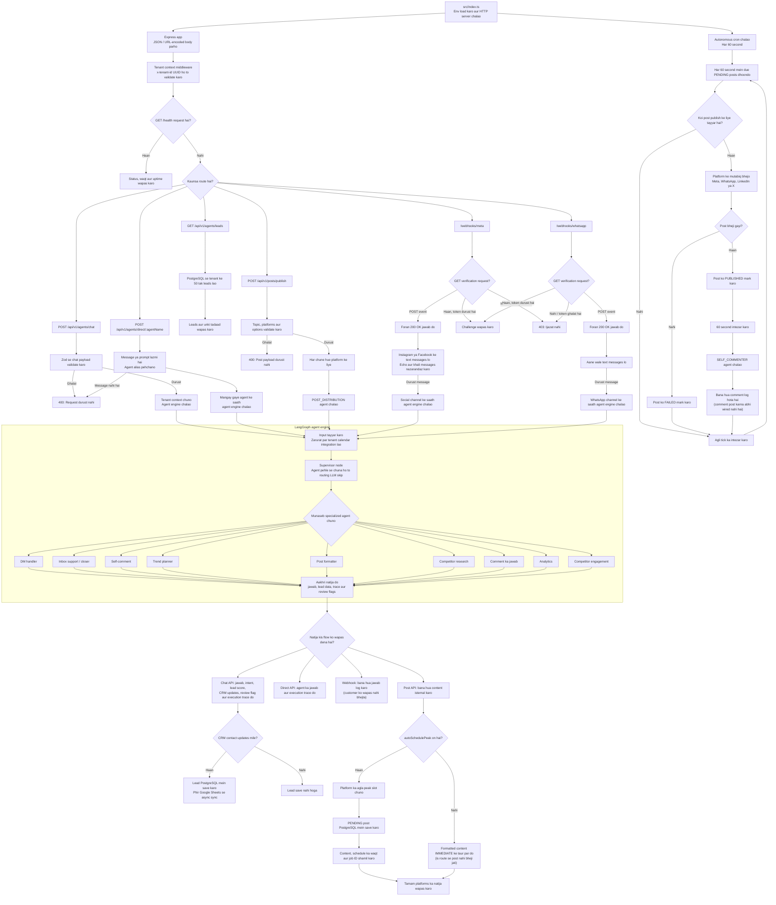

# Application ka Flow

SMMA backend mein request, agents, social posts aur schedule kiye gaye jobs ka flow:

## Diagram (seedha nazar aane wala)

```text
 Clients / Social Platforms
            |
            v
   Express API (src/app.ts) <------------------- Cron (har 60 second)
            |                                             |
   Tenant context middleware                              v
            |                                   Waqt par tay posts dhoondo
     +------+------+------+                                |
     |             |      |                                v
     v             v      v                       Social platform par bhejo
 Agent APIs    Post API  Webhooks                         |
     |             |      |                                v
     |             |      +--> Foran 200 OK jawab         PUBLISHED / FAILED mark karo
     |             |             |                         |
     |             |             +--> Agent Engine         +--> 60 second baad:
     |             |                       |                    self-comment agent chalao
     |             |                       v
     |             |             Bana hua jawab log hota hai
     |             |             (customer ko nahi bheja jata)
     |             |
     |             +--> POST_DISTRIBUTION agent
     |                       |
     |                Har platform ke liye post tayyar karo
     |                       |
     |              Kya peak time par schedule karna hai?
     |                 /           \
     |               Haan           Nahi
     |                |              |
     |         PENDING post save  IMMEDIATE ke taur par jawab
     |         karo PostgreSQL mein (yahan se bheja nahi jata)
     |                |
     |                +-------> Waqt aane par Cron post uthata hai
     |
     +--> Chat / Direct agent ki request
                  |
                  v
             Agent Engine
        Input aur tenant info tayyar karo
                  |
             Supervisor agent
                  |
       +----------+-----------+----------------------+
       |          |           |                      |
       v          v           v                      v
    DM handler  Support    Content, research    Analytics /
                / closer  aur comment agents   engagement agents
       |          |           |                      |
       +----------+-----------+----------------------+
                              |
                              v
                 Jawab + chalne ke steps ka record
                    /                  \
          Caller ko jawab do      Kya contact details mili?
                                        |
                                  Lead database mein save karo
                                  + Google Sheets se sync

 GET /api/v1/agents/leads ----------------> Tenant ke leads PostgreSQL se lao
 GET /health ----------------------------> Health status ka jawab
```

## Tafseeli Mermaid diagram



## Aham hisson ki wazahat

- **Agent ka jawab:** Khaas nodes Qwen/Groq JSON client ko call karte hain. Support/closer node tenant ke knowledge base se bhi maloomat leta hai.
- **Tenant ka data:** PostgreSQL mein leads aur schedule ki hui posts save hoti hain. Lead data Google Sheets se bhi sync ho sakta hai.
- **Social posts bhejna:** Schedule ki hui posts, platform credentials ke zariye social dispatcher bhejta hai.
- **Webhook ke jawab:** Meta aur WhatsApp webhooks agent ka jawab banate hain, lekin filhal sirf record karte hain; customer ko DM bhejna in handlers mein wired nahi hai.
- **Band karna:** `SIGTERM` ya `SIGINT` par cron timer rukta hai aur HTTP server araam se band hota hai.
- **Ghalatiyan:** Ghalat payload par `400`, route fail hone par `500` milta hai; Express error handler baqi ghalatiyan record karta hai.
