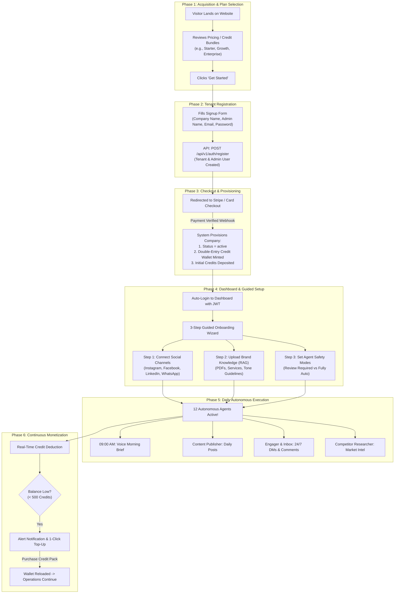

# Styre-BOT: End-to-End SaaS Application Flow & System Architecture

> **Audience:** Product Managers, Frontend Engineers, Backend Developers, and Stakeholders.  
> **Architecture Principle:** 100% Usage-Based & Credit-Driven Monetization. **All 12 AI Agents are completely unlocked for every customer from Day 1.** Revenue is driven by continuous credit consumption and top-up pack purchases.

---

## 1. Executive Summary & Business Model

Styre-BOT is an autonomous multi-agent social media and marketing automation SaaS designed for modern businesses and marketing agencies.

### Core Philosophy:
1. **Zero Artificial Feature-Gating:** Every registered tenant gets access to the full autonomous agent workforce (Supervisor, Researcher, Publisher, Engager, Inbox Responder, Daily Voice Brief, etc.). No user is restricted to a subset of agents.
2. **Pure Credit-Driven Monetization:**
   - Every agent task (generating a post, synthesizing audio, answering a DM, or scraping competitor insights) deducts credits in real time via our **Double-Entry Ledger**.
   - Plans/Cards on the website represent **Credit Bundles**, not feature locks.
   - Users continuously buy **Top-Up Packs** as their business scales and their agents execute high-volume autonomous operations.

---

## 2. End-to-End User Journey Map



---

## 3. Detailed Step-by-Step Breakdown

### Step 1: Website Landing Page & Credit Bundles
When a visitor views the pricing page, cards reflect **monthly credit capacity and operational volume**, rather than restricting features:

| Plan / Card | Monthly Credits | Agents Included | Social Channels | Target Audience |
| :--- | :--- | :--- | :--- | :--- |
| **Starter Bundle** | **5,000 Credits** | **All 12 Agents Unlocked** | 3 Channels | Solopreneurs & Small Brands |
| **Growth Bundle** | **25,000 Credits** | **All 12 Agents Unlocked** | 10 Channels | Growing Businesses & Active Brands |
| **Agency / Scale** | **100,000 Credits** | **All 12 Agents Unlocked** | Unlimited | High-Volume Marketing Agencies |

---

### Step 2: Company & User Signup
- **Frontend Action:** User enters Company Name, Admin Email, Password, and Timezone.
- **Backend API:** `POST /api/v1/auth/register`
- **Database Mutated:**
  - `companies`: Row inserted with initial `status = 'pending_payment'`.
  - `users`: User created with `role = 'company_admin'`.

---

### Step 3: Payment Gateway & Credit Wallet Provisioning
1. User completes checkout via Stripe or Payment Gateway.
2. Webhook triggers backend activation:
   - `companies.status` updated to `'active'`.
   - `credit_wallets`: Primary company wallet created with initial balance.
   - `credit_transactions`: Double-entry record inserted (`type = 'purchase'`).
3. User receives JWT session token and is redirected to the Dashboard.

---

### Step 4: 3-Step Guided Onboarding Wizard
To ensure agents operate with pinpoint brand accuracy, new users complete a 3-step setup:

```
+-----------------------------------------------------------------------------------+
|                            WELCOME TO STYRE-BOT                                   |
|                                                                                   |
|  [ Step 1: Connect Platforms ] -> [ Step 2: Brand Context ] -> [ Step 3: Safety ] |
+-----------------------------------------------------------------------------------+
```

1. **Step 1 — Connect Social Accounts:**
   - 1-Click OAuth connection for Instagram, Facebook Pages, LinkedIn, and WhatsApp Cloud API.
   - Endpoint: `POST /api/v1/connectors/accounts/{id}/test` validates Graph API tokens.
2. **Step 2 — Brand Knowledge Base (RAG Training):**
   - User uploads company brochures, product catalogs, FAQ documents, or website URLs.
   - File is parsed, chunked, and embedded into Vector Storage (`pgvector` / `Qdrant`) under `WHERE company_id = tenant_id`.
   - Agents now respond with strict brand voice, verified pricing, and domain expertise.
3. **Step 3 — Agent Safety & Guardrails:**
   - **Review Required:** New posts and complex replies land in the `Approval Queue` for human click-to-approve.
   - **Fully Autonomous:** Posts and replies dispatch directly via the Outbox once verified by internal guardrails.
   - **Pacing Limits:** Max posts per day (e.g., 3 posts/day) and max replies per hour (e.g., 20/hr).

---

## 4. Daily Autonomous Multi-Agent Operations

Once onboarded, the system runs 24/7 without requiring manual human micromanagement:

```mermaid
sequenceDiagram
    autonumber
    actor Admin as Company Admin
    participant DB as Daily Brief (#5)
    participant Pub as Publisher (#8)
    participant Eng as Engager (#1, #3)
    participant Outbox as Outbox Queue (24h TTL)
    participant Meta as Instagram / LinkedIn

    Note over DB: 09:00 AM Cron Trigger
    DB->>Admin: Delivers 2-minute Audio & 
    Text Morning Brief
    
    Note over Pub: Scheduled / Autonomous Workflow
    Pub->>Pub: Drafts Posts with RAG Brand Context
    Pub->>Outbox: Queues Post with Pacing Delay
    Outbox->>Meta: Dispatches Post to Live Channel
    
    Note over Eng: Customer Comments / DMs Arrival
    Meta->>Eng: Inbound Webhook (New Comment / DM)
    Eng->>Eng: Checks Guardrails & Sentiment
    Eng->>Outbox: Queues Personalized Human-Tone Reply
    Outbox->>Meta: Posts Reply after Safe Random Jitter (2-7 mins)
```

### Core Agents in Action:
- **Agent #5 (Daily Brief):** Generates daily morning audio briefing summarizing yesterday's analytics, hot leads, pending approvals, and competitor moves.
- **Agent #8 (Publisher):** Auto-schedules calendar content, hashtags, and visual ideas.
- **Agent #1, #3 & #9 (Engagers & Inbox):** Instant human-like comment responses and lead qualifying via DMs.
- **Agent #2 (Competitor Researcher):** Continuously monitors competitor channels and extracts offer changes and high-performing themes.
- **Agent #0 (Supervisor):** Autonomous DAG planner orchestrating complex multi-agent workflows.

---

## 5. Monetization & Credits Engine Architecture

Our financial foundation relies on an immutable **Double-Entry Ledger**:

### Credit Cost Schedule:
| Action | Credits Deducted | Value Delivered |
| :--- | :---: | :--- |
| **Social Media Post Generation** | **5 Credits** | Caption, hashtags, brand compliance |
| **Customer DM / Comment Reply** | **2 Credits** | Semantic search + contextual human reply |
| **Competitor Deep Analysis** | **15 Credits** | Complete competitive report |
| **Audio Voice Brief Synthesis** | **10 Credits** | Natural human voice audio generation |
| **Autonomous Supervisor Cycle** | **25 Credits** | End-to-end multi-agent orchestration |

### Top-Up Packages (Recurring Revenue):
When a tenant's wallet drops below threshold (e.g., `< 500 Credits`), the UI prompts:
- **Starter Boost:** 5,000 Credits — \$25
- **Growth Pack:** 25,000 Credits — \$100
- **Scale Bundle:** 100,000 Credits — \$350

Payments instantly mint credits via `ledger.grant()`, ensuring continuous uptime without interruption.

---

## 6. Enterprise Safety, Disconnect & Outbox Rules

To guarantee enterprise compliance and brand safety:

1. **Conversational Platform Disconnect:**
   - Users can disconnect channels via settings or natural language Copilot chat (*"insta ko disconnect kardo"*).
   - Platform status changes to `disconnected`.
2. **Instant Stale Job Purge:**
   - The moment a platform is disconnected, **all pending outbox jobs for that account are immediately updated to `expired`**.
   - If an account remains disconnected for 30, 40, 50 days, or a whole year, reconnecting it will **never blast out stale, outdated posts**.
3. **Strict 24-Hour Outbox TTL (PRD Section 6.2):**
   - Any queued job older than 24 hours (`not_before < NOW() - INTERVAL '24 hours'`) automatically expires, preventing accidental outdated interactions.
4. **Sentiment & Legal Escalation:**
   - Any high-friction comment (legal threats, severe refund disputes, hostile sentiment) automatically freezes auto-reply and alerts human managers in the **Approval Queue**.

---

## 7. Key API Endpoints for Frontend Integration

| Endpoint | Method | Purpose |
| :--- | :---: | :--- |
| `/api/v1/auth/register` | `POST` | Registers new tenant & admin user |
| `/api/v1/auth/login` | `POST` | User login returning JWT token |
| `/api/v1/credits/balance` | `GET` | Fetches real-time company credit balance |
| `/api/v1/credits/topup` | `POST` | Purchases credit pack via payment session |
| `/api/v1/connectors/accounts` | `GET` | Lists connected social accounts & status |
| `/api/v1/connectors/accounts/{id}/disconnect` | `POST` | Disconnects channel & purges pending jobs |
| `/api/v1/connectors/accounts/{id}/reconnect` | `POST` | Re-activates channel safely |
| `/api/v1/orchestration/copilot` | `POST` | Natural language chat assistant |
| `/api/v1/approvals` | `GET` | Lists posts/replies requiring human sign-off |
| `/api/v1/outbox` | `GET` | Lists queued outbox dispatches with 24h TTL |
