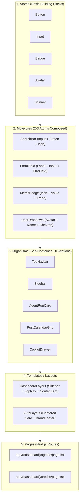
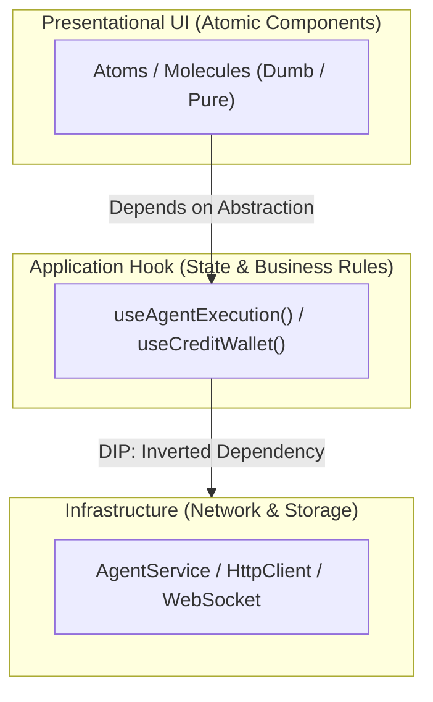

# Styre-BOT — Frontend Architecture Specification
**Standards:** Domain-Driven Design (DDD), SOLID Principles, Atomic Design System, DRY & KISS  
**Target Stack:** Next.js (App Router), TypeScript, Tailwind CSS, TanStack Query, Zustand, CVA (Class Variance Authority)

---

## 1. Architectural Philosophy & Core Mandates

Styre-BOT is a high-concurrency, multi-tenant B2B AI SaaS featuring 12 autonomous agents, credit-gated execution, real-time SSE streaming, and outbox event synchronization.

To maintain long-term maintainability, velocity, and visual consistency across the entire engineering team, the frontend architecture is governed by four core pillars:
1. **Domain-Driven Design (DDD):** Business logic is strictly sliced into isolated domain modules (`domains/*`).
2. **SOLID Principles:** Every component, hook, and adapter adheres to single responsibility, dependency inversion, and granular contracts.
3. **Atomic Design System:** Visual UI primitives are built hierarchically (**Atoms ➔ Molecules ➔ Organisms ➔ Templates ➔ Pages**).
4. **DRY & KISS Mandate:** Zero copy-paste duplication (DRY) combined with pragmatic, flat, simple code structures without premature over-engineering (KISS).

---

## 2. Core Engineering Mandates: DRY & KISS

### 🎯 DRY (Don't Repeat Yourself)
* **Single Source of Truth for Types:** Never manually write backend DTO interfaces. Types are generated directly from the backend [openapi.json](file:///d:/saas/Styre-BOT/docs/openapi.json) contract.
* **Shared UI Primitives:** Never rewrite Tailwind button styling (`bg-blue-600 px-4 py-2 rounded font-semibold...`) in multiple places. Use the canonical `<Button>` Atom with variants.
* **Reusable Async Hooks:** Logic for pagination, debounced search inputs, modal disclosure, and SSE streaming must live in reusable hooks in `shared/hooks/`, not re-invented inside views.
* **Centralized API Error & Rate Limit Handling:** All HTTP 429 sliding-window headers, 401 token refreshes, and toast notifications are handled centrally in the HTTP client interceptor.

### 🧘 KISS (Keep It Simple, Stupid)
* **No Premature Abstraction:** Do NOT build an `AbstractGenericFilterableSortableVirtualTableFactory<T>` when a clean 60-line component handles the exact requirement.
* **Shallow Nesting:** Keep component trees flat. Avoid nesting deeper than 3 levels of component wrapping.
* **Lightweight State Management:** Do NOT introduce complex Redux sagas or heavy boilerplate. Use **TanStack Query** for server data and **Zustand** for local UI state (modals, drawers).
* **Readable Code > Clever Code:** Write explicit TypeScript code that any junior or senior developer can understand within 30 seconds of inspection.

---

## 3. Atomic Design System (UI Component Architecture)

All visual components in `src/shared/ui/` must strictly follow the **Atomic Design Hierarchy**:



### Hierarchy Breakdown & Rules:

| Layer | Path | Definition & Responsibilities | Example |
|---|---|---|---|
| **1. Atoms** | `shared/ui/atoms/` | Indivisible HTML elements with standard styling variants (using `cva`). **Zero business logic, zero state.** | `<Button variant="primary">`, `<Badge status="active">`, `<Input>` |
| **2. Molecules** | `shared/ui/molecules/` | Combinations of 2 to 3 atoms functioning as a single visual unit. Simple UI state only (e.g. input focus). | `<FormField label="Email" error={...}>`, `<SearchBar placeholder="...">` |
| **3. Organisms** | `shared/ui/organisms/` | Complex, standalone UI blocks composed of molecules and atoms. Can bind to custom hooks or accept composite callbacks. | `<AgentRunCard>`, `<PostCalendarGrid>`, `<CopilotChatDrawer>` |
| **4. Templates** | `shared/ui/templates/` | Pure layout wrappers defining page wireframes with responsive grid slots. Zero content data. | `<DashboardLayout>`, `<SplitPaneWorkspaceLayout>` |
| **5. Pages** | `app/**/page.tsx` | Next.js route entry points that fetch domain data via DDD hooks and populate Template slots with Organisms. | `app/(dashboard)/agents/page.tsx` |

---

## 4. SOLID Principles in Frontend Engineering



### 1. Single Responsibility Principle (SRP)
* **Rule:** A component must only render UI; a custom hook must only manage state and side effects; an API file must only handle network transportation.
* **Anti-Pattern:** A `PostPublisher.tsx` file that calls `fetch('/api/v1/social/posts')`, parses errors, tracks form state, handles video playback, and renders 400 lines of Tailwind JSX.
* **Refactored:**
  * `useCreatePost()`: TanStack Query hook managing mutation, cache invalidation, and 429 rate-limit backoff.
  * `PostPublisherForm.tsx`: Pure presentational form receiving state and callbacks via props.
  * `social.api.ts`: Pure typed network request returning `Promise<SocialPostDTO>`.

### 2. Open/Closed Principle (OCP)
* **Rule:** Entities should be open for extension, but closed for modification.
* **Implementation:** Use polymorphic variants (`cva`) in atoms and registry-based renderers for agents:
  ```typescript
  // Extensible Registry (Open for new agents, closed for modification)
  export const AGENT_CARD_REGISTRY: Record<string, React.FC<AgentCardProps>> = {
    'own-post-engager': OwnPostEngagerCard,
    'competitor-researcher': CompetitorResearcherCard,
    'supervisor': SupervisorDagCard,
  };
  ```

### 3. Liskov Substitution Principle (LSP)
* **Rule:** All sub-elements and adapters must adhere to the contract of their base abstraction.
* **Implementation:** All Input and Button atoms must extend standard HTML attributes without breaking standard behavior:
  ```typescript
  interface ButtonProps extends React.ButtonHTMLAttributes<HTMLButtonElement>, VariantProps<typeof buttonVariants> {
    isLoading?: boolean;
    leftIcon?: React.ReactNode;
  }
  ```

### 4. Interface Segregation Principle (ISP)
* **Rule:** Components should not be forced to depend on interfaces they do not use.
* **Anti-Pattern:** Passing the entire 30-field `AgentRunDTO` to a simple `AgentAvatar` component.
* **Refactored:**
  ```typescript
  // Bad
  function AgentAvatar({ run }: { run: AgentRunDTO }) { ... }

  // Good
  interface AgentAvatarProps {
    agentCode: string;
    size?: 'sm' | 'md' | 'lg';
  }
  function AgentAvatar({ agentCode, size = 'md' }: AgentAvatarProps) { ... }
  ```

### 5. Dependency Inversion Principle (DIP)
* **Rule:** High-level UI modules must depend on abstractions (hooks/interfaces), not low-level concrete implementations (raw `fetch` or direct `axios` instances).
* **Implementation:** Network calls are injected through an abstract `HttpClient` that handles JWT refresh tokens, tenant headers, and sliding-window `Retry-After` auto-retry logic transparently.

---

## 5. Domain-Driven Design (DDD) Directory Layout

```
apps/web/src/
├── app/                          # Next.js App Router (Routing entry points only)
│   ├── (auth)/login/page.tsx
│   ├── (dashboard)/layout.tsx
│   ├── (dashboard)/agents/page.tsx
│   ├── (dashboard)/social/page.tsx
│   ├── (dashboard)/credits/page.tsx
│   └── (dashboard)/knowledge/page.tsx
│
├── domains/                      # Domain Feature Slices (DDD Core)
│   ├── agents/                   # Agent Orchestration Domain
│   │   ├── components/           # Domain Organisms (AgentCard, DagViewer, RunLog)
│   │   ├── hooks/                # useAgentRun, useAgentStream, useSupervisor
│   │   ├── api/                  # agents.api.ts (matching /api/v1/agents)
│   │   └── types/                # AgentRun, TaskDag, AgentCode
│   │
│   ├── credits/                  # Double-Entry Billing & Wallet Domain
│   │   ├── components/           # WalletPill, PackPurchaseModal, LedgerTable
│   │   ├── hooks/                # useCreditWallet, useCheckoutPack
│   │   ├── api/                  # credits.api.ts
│   │   └── types/                # Wallet, CreditPack, LedgerTransaction
│   │
│   ├── social/                   # Social Content & Pacing Domain
│   │   ├── components/           # PostCalendar, CommentDrawer, MediaPreview
│   │   ├── hooks/                # useSocialPosts, useApprovePost
│   │   ├── api/                  # social.api.ts
│   │   └── types/                # SocialPost, Comment, OutboxJob
│   │
│   ├── campaigns/                # Outreach & Inbound Concierge Domain
│   │   ├── components/           # SequenceBuilder, ContactUploader, InboxThread
│   │   ├── hooks/                # useCampaigns, useInboxMessages
│   │   ├── api/                  # campaigns.api.ts
│   │   └── types/                # Prospect, SequenceStage, Message
│   │
│   └── knowledge/                # Vector RAG & Training Domain
│       ├── components/           # DocUploader, ChunkViewer, SopQuiz
│       ├── hooks/                # useKnowledgeDocs, useSlidingAnalyze
│       ├── api/                  # knowledge.api.ts
│       └── types/                # KnowledgeDoc, DocumentChunk, SopModule
│
└── shared/                       # Shared Cross-Cutting Design System & Infra
    ├── ui/                       # Atomic Design Hierarchy
    │   ├── atoms/                # Button, Input, Badge, Avatar, Spinner, Tooltip
    │   ├── molecules/            # FormField, SearchBar, StatBadge, UserDropdown
    │   ├── organisms/            # TopNavbar, Sidebar, UniversalConfirmModal
    │   └── templates/            # DashboardLayout, AuthLayout, SplitPaneLayout
    │
    ├── http/                     # Axios/Fetch Client, Interceptors, 429 Handlers
    ├── hooks/                    # useWebSocket, useSSE, useDebounce, useMediaQuery
    ├── store/                    # Global UI State (theme, active drawer, sidebar state)
    └── utils/                    # formatCurrency, formatDate, truncate
```

---

## 6. State Management Taxonomy

| State Type | Solution | Usage & Rules |
|---|---|---|
| **Server State** | **TanStack Query (React Query)** | All API data fetching, caching, deduplication, optimistic updates, and cache invalidation on mutations. |
| **Streaming State** | **Custom SSE Hook (`useSSE`)** | For real-time LLM token streaming (`/copilot/chat/stream`, `/agents/{id}/stream`). |
| **Real-time Events** | **WebSocket Context** | Listens to Redis pub/sub push events (`outbox.updated`, `rag.progress`, `approvals.needed`). |
| **Client UI State** | **Zustand** | Modals visibility, active drawer selections, temporary audio playback state. |
| **Form State** | **React Hook Form + Zod** | Validation schemas mirroring backend Pydantic models. |

---

## 7. Rate Limiting & 429 Sliding-Window Frontend Handling

The backend injects standard RFC sliding-window headers on sensitive endpoints:
* `X-RateLimit-Limit`
* `X-RateLimit-Remaining`
* `X-RateLimit-Reset`
* `Retry-After` (on 429 status)

### Frontend Interceptor Contract
When a `429 Too Many Requests` response is received:
1. Do NOT crash or display a blank error screen.
2. Read the `Retry-After` header value (seconds).
3. Surface a non-intrusive countdown toast or inline cooldown progress bar (`"Rate limit reached. Auto-resuming in 14s..."`).
4. Automatically re-enable the trigger button once the cooldown timer reaches zero.

---

## 8. Type-Safety Strategy (Zero Manual Typing)

The backend exposes an up-to-date OpenAPI 3.1 specification at [openapi.json](file:///d:/saas/Styre-BOT/docs/openapi.json).
The frontend team must automatically generate TypeScript interfaces using:
```bash
npx openapi-typescript ../../docs/openapi.json -o src/shared/http/api-schema.d.ts
```
This guarantees 100% contract synchronization between FastAPI backend routes and Next.js frontend mutations.
