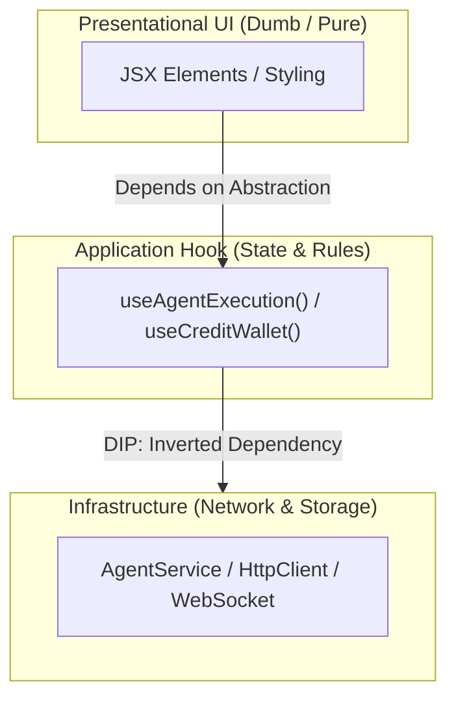

# Styre-BOT — Frontend Architecture Specification
**Standard:** Domain-Driven Design (DDD) & SOLID Principles  
**Target Stack:** Next.js (App Router), TypeScript, Tailwind CSS, TanStack Query, Zustand

---

## 1. Architectural Philosophy

Styre-BOT is a high-concurrency, multi-tenant B2B AI SaaS featuring 12 autonomous agents, credit-gated execution, real-time SSE streaming, and outbox event synchronization.

To avoid frontend monolithic spaghetti (where single files exceed 500 lines mixing API calls, state machines, and JSX), the frontend engineering team must strictly enforce:
1. **Domain-Driven Design (DDD):** Code is sliced into isolated, cohesive domain boundaries (`domains/*` or `features/*`) that mirror backend business modules.
2. **SOLID Principles:** Every component, hook, and service has a single responsibility, depends on abstractions, and exposes granular contracts.

---

## 2. SOLID Principles in Frontend Engineering



### 1. Single Responsibility Principle (SRP)
* **Rule:** A component must only render UI; a custom hook must only manage state and side effects; an API file must only handle network transportation.
* **Anti-Pattern:** A `PostPublisher.tsx` file that calls `fetch('/api/v1/social/posts')`, parses errors, tracks form state, handles video playback, and renders 400 lines of Tailwind JSX.
* **Refactored:**
  * `useCreatePost()`: TanStack Query hook managing mutation, cache invalidation, and 429 rate-limit backoff.
  * `PostPublisherForm.tsx`: Pure presentational form receiving state and callbacks via props.
  * `social.api.ts`: Pure typed network request returning `Promise<SocialPostDTO>`.

### 2. Open/Closed Principle (OCP)
* **Rule:** Entities should be open for extension, but closed for modification.
* **Implementation:** Use component composition, polymorphic render props, and registry-based agent renders.
  * When adding Agent #13, developers must NOT edit a 20-case `switch(agentId)` statement. Instead, register the new agent card into an extensible map:
  ```typescript
  export const AGENT_CARD_REGISTRY: Record<string, React.FC<AgentCardProps>> = {
    'own-post-engager': OwnPostEngagerCard,
    'competitor-researcher': CompetitorResearcherCard,
    'supervisor': SupervisorDagCard,
  };
  ```

### 3. Liskov Substitution Principle (LSP)
* **Rule:** Subtypes or swappable adapters must adhere to the contract of their base abstraction.
* **Implementation:** Social connector accounts (LinkedIn, Twitter, Meta, Instagram) must implement a common `ConnectorAccountUI` interface:
  ```typescript
  interface ConnectorAccount {
    id: string;
    provider: 'linkedin' | 'twitter' | 'facebook' | 'instagram';
    displayName: string;
    status: 'connected' | 'disconnected' | 'rate_limited' | 'error';
    hourlyQuota: { sent: number; max: number };
  }
  ```

### 4. Interface Segregation Principle (ISP)
* **Rule:** Components should not be forced to depend on interfaces they do not use.
* **Anti-Pattern:** Passing the entire 30-field `AgentRunDTO` to a simple `AgentAvatar` component.
* **Refactored:**
  ```typescript
  // Bad
  function AgentAvatar({ run }: { run: AgentRunDTO }) { ... }

  // Good
  interface AgentAvatarProps {
    agentCode: string;
    size?: 'sm' | 'md' | 'lg';
  }
  function AgentAvatar({ agentCode, size = 'md' }: AgentAvatarProps) { ... }
  ```

### 5. Dependency Inversion Principle (DIP)
* **Rule:** High-level UI modules must depend on abstractions (hooks/interfaces), not low-level concrete implementations (raw `fetch` or direct `axios` instances).
* **Implementation:** Network calls are injected through an abstract `HttpClient` that handles JWT refresh tokens, tenant headers, and sliding-window `Retry-After` auto-retry logic transparently.

---

## 3. Domain-Driven Design (DDD) Directory Layout

```
apps/web/src/
├── app/                          # Next.js App Router (Routing only, zero business logic)
│   ├── (auth)/login/page.tsx
│   ├── (dashboard)/layout.tsx
│   ├── (dashboard)/agents/page.tsx
│   ├── (dashboard)/social/page.tsx
│   ├── (dashboard)/credits/page.tsx
│   └── (dashboard)/knowledge/page.tsx
│
├── domains/                      # Domain Slices (DDD Core)
│   ├── agents/                   # Agent Orchestration Domain
│   │   ├── components/           # Domain-specific UI (AgentCard, DagViewer, RunLog)
│   │   ├── hooks/                # useAgentRun, useAgentStream, useSupervisor
│   │   ├── api/                  # agents.api.ts (matching /api/v1/agents)
│   │   └── types/                # AgentRun, TaskDag, AgentCode
│   │
│   ├── credits/                  # Double-Entry Billing & Wallet Domain
│   │   ├── components/           # WalletPill, PackPurchaseModal, LedgerTable
│   │   ├── hooks/                # useCreditWallet, useCheckoutPack
│   │   ├── api/                  # credits.api.ts
│   │   └── types/                # Wallet, CreditPack, LedgerTransaction
│   │
│   ├── social/                   # Social Content & Pacing Domain
│   │   ├── components/           # PostCalendar, CommentDrawer, MediaPreview
│   │   ├── hooks/                # useSocialPosts, useApprovePost
│   │   ├── api/                  # social.api.ts
│   │   └── types/                # SocialPost, Comment, OutboxJob
│   │
│   ├── campaigns/                # Outreach & Inbound Concierge Domain
│   │   ├── components/           # SequenceBuilder, ContactUploader, InboxThread
│   │   ├── hooks/                # useCampaigns, useInboxMessages
│   │   ├── api/                  # campaigns.api.ts
│   │   └── types/                # Prospect, SequenceStage, Message
│   │
│   └── knowledge/                # Vector RAG & Training Domain
│       ├── components/           # DocUploader, ChunkViewer, SopQuiz
│       ├── hooks/                # useKnowledgeDocs, useSlidingAnalyze
│       ├── api/                  # knowledge.api.ts
│       └── types/                # KnowledgeDoc, DocumentChunk, SopModule
│
└── shared/                       # Shared Cross-Cutting Infrastructure
    ├── ui/                       # Design System Primitives (Button, Modal, Drawer, Table, Badge)
    ├── http/                     # Axios/Fetch client, Interceptors, 429 Handlers
    ├── hooks/                    # useWebSocket, useSSE, useDebounce, useMediaQuery
    ├── store/                    # Global UI state (theme, active tenant, sidebar state)
    └── utils/                    # formatCurrency, formatDate, truncate
```

---

## 4. State Management Taxonomy

| State Type | Solution | Usage & Rules |
|---|---|---|
| **Server State** | **TanStack Query (React Query)** | All API data fetching, caching, deduplication, optimistic updates, and cache invalidation on mutations. |
| **Streaming State** | **Custom SSE Hook (`useSSE`)** | For real-time LLM token streaming (`/copilot/chat/stream`, `/agents/{id}/stream`). |
| **Real-time Events** | **WebSocket Context** | Listens to Redis pub/sub push events (`outbox.updated`, `rag.progress`, `approvals.needed`). |
| **Client UI State** | **Zustand** | Modals visibility, active drawer selections, temporary audio playback state. |
| **Form State** | **React Hook Form + Zod** | Validation schemas mirroring backend Pydantic models. |

---

## 5. Rate Limiting & 429 Sliding-Window Frontend Handling

The backend injects standard RFC sliding-window headers on sensitive endpoints:
* `X-RateLimit-Limit`
* `X-RateLimit-Remaining`
* `X-RateLimit-Reset`
* `Retry-After` (on 429 status)

### Frontend Interceptor Contract
When a `429 Too Many Requests` response is received:
1. Do NOT crash or display a blank error screen.
2. Read the `Retry-After` header value (seconds).
3. Surface a non-intrusive countdown toast or inline cooldown progress bar (`"Rate limit reached. Auto-resuming in 14s..."`).
4. Automatically re-enable the trigger button once the cooldown timer reaches zero.

---

## 6. Type-Safety Strategy (Zero Manual Typing)

The backend exposes an up-to-date OpenAPI 3.1 specification at [openapi.json](file:///d:/saas/Styre-BOT/docs/openapi.json).
The frontend team must automatically generate TypeScript interfaces using:
```bash
npx openapi-typescript ../../docs/openapi.json -o src/shared/http/api-schema.d.ts
```
This guarantees 100% contract synchronization between FastAPI backend routes and Next.js frontend mutations.
