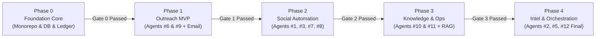

# 🚀 Styre-BOT — Master Execution Phases & Implementation Roadmap (`execution-phases.md`)

> **Comprehensive Step-by-Step Backend Architecture & Development Plan for 12-Agent SaaS Monorepo.**

---

## 🧭 Roadmap Overview & Phase Architecture

Is document ka maqsad pooray project ko structured, milestone-driven aur actionable phases mein divide karna hai. Har phase tabhi complete consider hoga jab uska specific **Quality Gate** pass hoga.

---

## 📍 Phase 0: Foundation Core & Infrastructure Setup

**Goal:** Monorepo infrastructure, shared packages, database migrations from `ERD.sql`, double-entry credit ledger, auth/RBAC middleware, aur `BaseAgent` core framework tayar karna.

### Deliverables:
- Database schema and migrations matching [`ERD.sql`](file:///d:/saas/Styre-BOT/ERD.sql) in `@packages/db`.
- Immutable double-entry credit ledger engine in `@packages/db` and `apps/api`.
- `@packages/agent-core` with `BaseAgent` abstract class, execution lifecycle, Zod schema validation, and audit logger.
- Unified REST API framework in `apps/api` with tenant isolation middleware (`company_id` injection & RLS).
- BullMQ queue initialization in `apps/worker` for distributed background execution.

### Implementation Checklist:
- [ ] **Step 0.1: Monorepo Package Setup**
  - `@packages/tsconfig`: Shared compilation presets (`base.json`, `node.json`, `nextjs.json`).
  - `@packages/db`: PostgreSQL 16 connection pool (`pg`), tenant scoping helper (`withTenantContext`), and migration runner for `ERD.sql`.
  - `@packages/agent-core`: `BaseAgent` class (`plan()`, `run()`, `estimateCredits()`), execution status enums, tool registry.
  - `@packages/llm`: Unified LLM client (Qwen 2.5 / Groq / Claude), prompt template manager, USD token cost calculation.
- [ ] **Step 0.2: Database Migration & Seeding**
  - Run `ERD.sql` migration script to create all 9 module tables and custom ENUMs.
  - Seed master `agents` table (Agents 1 through 12) with default modes (`draft` / `auto`).
  - Seed initial master `agent_actions` with default credit costs.
- [ ] **Step 0.3: Credit System & Double-Entry Ledger**
  - Implement `CreditLedgerService` with atomic operations: `purchase`, `allocate`, `reserve`, `consume`, `release`, `revoke`.
  - Enforce pre-execution balance check (reject if insufficient balance).
  - Implement 20% low-balance threshold alert trigger.
- [ ] **Step 0.4: Multi-Tenant REST API & Auth**
  - Setup Express API server in `apps/api/src/index.ts`.
  - Implement JWT Auth and RBAC middleware (`super_admin`, `company_admin`, `manager`, `employee`).
  - Implement `TenantMiddleware` (`x-tenant-id` header validation & RLS session setting).
  - Add Credit wallet API endpoints (`/api/v1/credits/balance`, `/api/v1/credits/allocate`).
- [ ] **Step 0.5: Queue & Worker Scaffolding**
  - Setup BullMQ queue connection in `apps/worker` using Redis 7.
  - Create base job processor for `agent-runs` queue.

> [!IMPORTANT]
> **Gate 0 Verification Criteria:**
> 1. `ERD.sql` completely migrated into PostgreSQL without any constraint errors.
> 2. Automated test: Credit reserve $\rightarrow$ dummy agent run $\rightarrow$ credit consume verifies exact ledger balance.
> 3. Tenant isolation test: Company A cannot query or mutate Company B's wallet or users.

---

## 📍 Phase 1: Outbound Outreach & Inbound Responder (MVP)

**Goal:** Pehla commercial use-case live karna: Cold email outreach campaigns (Agent #6) aur incoming email replies/triage (Agent #9), with OAuth email connectors aur anti-detection warmup limits.

### Deliverables:
- `@packages/connectors`: Google Gmail API (OAuth 2.0) and Microsoft Graph (Outlook) connectors.
- `agents/06-outreach`: Campaign generator, personalized email drafter, follow-up scheduler.
- `agents/09-inbox-responder`: Inbound webhook/IMAP listener, intent classifier (`Lead`, `Support`, `Spam`), auto-replier.
- Outbox pacing engine in `apps/worker` with per-account concurrency = 1 and warm-up rate limits.

### Implementation Checklist:
- [ ] **Step 1.1: Email Connectors (`@packages/connectors`)**
  - Google OAuth 2.0 exchange, token refresh handler, and AES-256 encrypted storage (`token_enc`).
  - Gmail API email sender adapter (draft mode vs direct send).
  - Microsoft Graph / SMTP fallback adapters.
- [ ] **Step 1.2: CRM & Contact List Engine**
  - CSV import parser with email syntax validation and duplicate deduplication.
  - Contact list segmentation and custom attributes support (`contacts`, `contact_lists`).
- [ ] **Step 1.3: Agent #6 (Outreach Engine)**
  - System prompts with prospect context injection.
  - Multi-stage sequence planner: Email 1 $\rightarrow$ Wait 3 days $\rightarrow$ Follow-up 1 $\rightarrow$ Follow-up 2 (Max 3 emails).
  - CAN-SPAM compliance: Mandatory 1-click unsubscribe header and suppression list check.
- [ ] **Step 1.4: Agent #9 (Inbox Responder & Inbound Triage)**
  - Inbound email webhook processor (Gmail Pub/Sub push / IMAP polling).
  - Sentiment & Intent classification using LLM (`Interested` $\rightarrow$ CRM stage update; `Complaint` $\rightarrow$ Human escalate).
  - Auto-drafting contextual replies based on thread history.
- [ ] **Step 1.5: Outbox Email Pacing Worker**
  - BullMQ paced worker: random 45s–3min delays between sent emails.
  - New account warm-up rule: Max 50 emails/day during first 14 days.
  - Auto-pause campaign if bounce rate exceeds 5%.

> [!IMPORTANT]
> **Gate 1 Verification Criteria:**
> 1. Complete end-to-end campaign executed: CSV upload $\rightarrow$ 10 test emails drafted in `draft` mode $\rightarrow$ approved $\rightarrow$ dispatched through Gmail API with valid pacing delays.
> 2. Inbound test email received $\rightarrow$ Agent #9 classifies intent and generates draft reply without duplicating.

---

## 📍 Phase 2: Social Media Automation & Anti-Detection Pacing

**Goal:** Multi-channel social media publishing, comment engagement, and anti-ban safeguards across Meta (Facebook & Instagram) and LinkedIn.

### Deliverables:
- `@packages/connectors`: Meta Graph API (Page tokens & Webhooks), LinkedIn Content Management API.
- `agents/08-publisher`: Content calendar post generator, image prompt creator, schedule publisher.
- `agents/03-comment-responder`: Real-time public comment responder with FAQ knowledge lookup.
- `agents/01-own-post-engager`: Post conversation starter comments & CTAs.
- `agents/07-competitor-engager`: Assisted mode competitor post tracker and comment drafter.
- Outbox Pacing Worker enhancements: Concurrency = 1, typing simulation, daily caps, and HTTP 429 auto-throttle.

### Implementation Checklist:
- [ ] **Step 2.1: Social Connectors & Webhooks**
  - Meta OAuth 2.0 flow for Page Access Tokens (encrypted storage).
  - Meta Webhook listener with HMAC SHA-256 signature verification (`x-hub-signature-256`).
  - LinkedIn OAuth 2.0 Organization API connector.
- [ ] **Step 2.2: Anti-Ban Social Pacing Engine (`apps/worker`)**
  - Implement strict FIFO outbox queue per `connected_account_id`.
  - Random jitter (45s–180s) + typing simulation (+10s–40s).
  - Operating hours window enforcement (e.g., 9:00 AM – 10:00 PM company timezone).
  - Consecutive message similarity check (prevents repetitive spam flags).
  - HTTP 429 / Action Blocked exponential backoff (30m $\rightarrow$ 2h $\rightarrow$ admin alert).
- [ ] **Step 2.3: Agent #8 (Publisher & Distributor)**
  - Content calendar schema, post generation from prompts/topics, status lifecycle (`draft` $\rightarrow$ `approved` $\rightarrow$ `scheduled` $\rightarrow$ `published`).
  - Trigger Agent #1 upon successful publication.
- [ ] **Step 2.4: Agent #3 (Comment Responder) & Agent #1 (Own-Post Engager)**
  - Scoped context isolation using `thread_key`.
  - Sentiment check: Auto-reply to inquiries/praise; escalate negative/legal disputes to approvals queue.
  - Agent #1 posts 1–2 initial CTA/conversation starter comments.
- [ ] **Step 2.5: Agent #7 (Competitor Engager - Assisted Mode)**
  - Competitor post tracker and draft composer.
  - Human-in-the-loop: comments are never posted automatically; strictly one-click approval required from employee.

> [!IMPORTANT]
> **Gate 2 Verification Criteria:**
> 1. Simulated post publication followed by Agent #1 automated conversation starter.
> 2. Webhook comment received $\rightarrow$ Agent #3 responds via paced outbox queue observing 45s+ delay without triggering API rate limit errors.

---

## 📍 Phase 3: Enterprise Knowledge Base & Operations (RAG & ERP)

**Goal:** Corporate knowledge base ingestion, semantic search with source citations, intern SOP onboarding, and read-only enterprise data connector framework.

### Deliverables:
- Vector RAG pipeline in `@packages/db` (Qdrant / `pgvector`) with strict tenant isolation.
- `agents/11-company-ops`: RAG-powered internal query responder with zero-hallucination citations.
- `agents/10-trainee-sop`: SOP training course generator, quiz evaluator, and tabular file parser.
- `@packages/connectors`: Enterprise connector framework (REST/GraphQL, read-only DB tunnel, S3 file sync).

### Implementation Checklist:
- [ ] **Step 3.1: Vector Pipeline & Chunking Engine**
  - Document ingestion service: PDF, DOCX, TXT parser.
  - Semantic text chunker (500 tokens with 50-token overlap).
  - Vector embeddings generator using text-embedding-3 or local embeddings.
  - Upsert to Qdrant / `pgvector` with mandatory metadata: `{ company_id, document_id, chunk_index }`.
- [ ] **Step 3.2: Agent #11 (Company Ops Agent & RAG)**
  - Strict tenant-scoped similarity search: `company_id = tenant_id`.
  - Contextual answer formulation with markdown source citations.
  - Hallucination guard: If score below confidence threshold, reply *"Information not found in company docs."*
- [ ] **Step 3.3: Enterprise Connector Framework**
  - Standard `IConnector` interface implementation:
    - `testConnection()`, `listResources()`, `getSchema()`, `query()`.
  - Read-Only SQL database connector (Postgres/MySQL) with SSH tunnel support.
  - REST/GraphQL API connector with dynamic JSON mapping.
- [ ] **Step 3.4: Agent #10 (Trainee & SOP Agent)**
  - SOP breakdown into modular learning sections (`sops` table).
  - Interactive quiz question generator and answer grading (`training_progress`).
  - Data task processor: Ingests unstructured CSV/Excel, performs aggregation, generates clean downloadable reports (`generated_files`).

> [!IMPORTANT]
> **Gate 3 Verification Criteria:**
> 1. 20 diverse technical questions tested against uploaded company SOP documents; 100% of answers provide exact citations and zero cross-tenant leakage.
> 2. Excel sheet ingested $\rightarrow$ Agent #10 generates structured monthly expense summary table with 0 math discrepancies.

---

## 📍 Phase 4: Competitive Intelligence, Advanced Orchestration & Scale

**Goal:** Advanced competitor research, daily action briefings, multi-step Supervisor execution DAG, and commercial multi-tenant self-serve billing.

### Deliverables:
- `agents/02-competitor-researcher`: Automated competitor social scraping, ad library analysis, and trend report compiler.
- `agents/05-daily-brief`: 9:00 AM daily executive summary of pending tasks, trending opportunities, and follow-ups.
- `agents/04-analytics`: Unified multi-channel performance snapshots and LLM cost margin analytics.
- `agents/12-supervisor`: Production multi-step DAG orchestrator with credit budget estimation, retry policies, and execution audit logging.
- Dummy Testing UI in `apps/web`: Complete dashboard demonstrating all 12 agents, credit wallets, and campaign controls.

### Implementation Checklist:
- [ ] **Step 4.1: Agent #2 (Competitor Researcher) & Agent #4 (Analytics)**
  - Public competitor tracking engine (Social profiles & Meta Ad Library).
  - Weekly analytical digest compilation (`competitor_insights`).
  - Agent #4 cross-platform ROI reporting, deal pipeline analytics, and aggregate LLM cost margins (`analytics_snapshots`).
- [ ] **Step 4.2: Agent #5 (Daily Brief)**
  - 9:00 AM Cron worker querying nightly insights from Agents #2, #3, #4, #6, #9.
  - Formats actionable morning digest with one-click `"Do It"` buttons.
- [ ] **Step 4.3: Agent #12 (Master Supervisor Orchestrator)**
  - Complex task parser: Converts natural language requests into multi-agent DAG workflows (e.g., *Research Competitor X $\rightarrow$ Draft 3 Posts $\rightarrow$ Request Approval $\rightarrow$ Schedule*).
  - Pre-flight credit budget computation and atomic reservation.
  - Distributed sub-job dispatching, dependency resolution, and retry watchdog (max 2 retries per step).
- [ ] **Step 4.4: Dummy Dashboard UI (`apps/web`)**
  - Clean Next.js 14 mock views for:
    - 12-Agent live status monitor and mode switcher (`draft` / `auto`).
    - Company & Employee credit wallet balance & ledger transaction history.
    - Outbox pacing monitor and active approval queue.

> [!IMPORTANT]
> **Gate 4 Verification Criteria:**
> 1. Single natural language command to Supervisor triggers multi-step execution across 3 distinct agents seamlessly with accurate credit consumption.
> 2. Full end-to-end integration test suite passes across all 12 agents.

---

## 📊 Summary of Phase Ownership & Architecture

| Phase | Core Objective | Primary Agents Involved | Primary Packages / Apps | Exit Gate |
|:---:|---|---|---|---|
| **Phase 0** | Foundation, Tenancy & Ledger | Core Infra & Supervisor v1 | `@packages/db`, `@packages/agent-core`, `apps/api`, `apps/worker` | Credit Ledger test green + `ERD.sql` migrated |
| **Phase 1** | Cold Email Outreach MVP | #6 (Outreach), #9 (Inbox Responder) | `@packages/connectors`, `agents/06`, `agents/09`, `apps/worker` | First real email campaign executed & paced |
| **Phase 2** | Social Media & Pacing Engine | #1, #3, #7, #8 | `@packages/connectors`, `agents/01,03,07,08`, `apps/worker` | Meta/LinkedIn webhooks & anti-ban pacing live |
| **Phase 3** | Knowledge Base & Enterprise Ops | #10 (Trainee/SOP), #11 (Ops/RAG) | `@packages/db`, `@packages/connectors`, `agents/10,11` | 20 SOP questions verified with 100% cited answers |
| **Phase 4** | Intel, Orchestration & Scale | #2, #4, #5, #12 (Full DAG) | `agents/02,04,05,12`, `apps/web` (Dummy UI) | Full multi-agent DAG execution complete |

